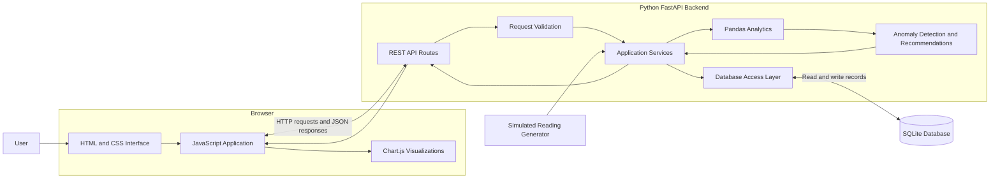

# AI-Assisted Smart Renewable Energy Monitoring Platform
## System Architecture

### 1. System Architecture Overview

The platform uses a layered web architecture. The browser presents the dashboard and visualizations, while a Python FastAPI backend handles requests, data validation, database access, and analysis. SQLite stores production readings and analysis results. Pandas processes readings for summaries, anomaly detection, and energy recommendations.

The application can use simulated readings to demonstrate solar and wind monitoring without physical sensors. Simulated readings should be clearly identified as such throughout the interface and analysis results.

**Main components:**

- **Frontend:** HTML, CSS, and JavaScript provide the user interface. Chart.js renders energy data as charts.
- **Backend API:** FastAPI exposes REST endpoints, validates requests, coordinates processing, and returns JSON responses.
- **Database:** SQLite stores readings and, where useful, detected anomalies and recommendations.
- **Analytics:** Pandas prepares and aggregates readings. Analysis logic detects unusual values and generates recommendations.

The frontend communicates with the backend over HTTP using JSON. The backend communicates with SQLite and the analytics layer; database details are not exposed directly to the browser.

### 2. Frontend Architecture

The frontend runs in the user’s browser and is organized into these responsibilities:

- **Dashboard view:** Displays overall production summaries, selected date range, and system status.
- **Energy source views:** Show solar and wind readings separately or together.
- **Filters and controls:** Let users select an energy source and time period, and request refreshed data.
- **Chart presentation:** JavaScript supplies data returned by the API to Chart.js for visualization.
- **Insights display:** Presents anomaly alerts and recommendations with brief explanations.
- **API communication:** Sends HTTP requests to FastAPI and handles returned JSON, loading states, and errors.

HTML defines the page structure, CSS controls layout and appearance, and JavaScript manages interactions and API responses. The frontend should label units and identify simulated data to avoid confusion about what the charts represent.

### 3. Backend Architecture

FastAPI acts as the application’s central coordinator. Requests from the frontend pass through the API layer and are routed to appropriate backend responsibilities:

1. **API routes:** Accept dashboard, readings, anomaly, and recommendation requests.
2. **Validation:** Check query parameters, date ranges, source names, and submitted values.
3. **Application services:** Coordinate reading retrieval, simulation requests, summaries, and analysis.
4. **Data access:** Read and write records in SQLite.
5. **Analytics services:** Use Pandas and the platform’s analysis rules to compute summaries and insights.
6. **Response handling:** Return structured JSON or a suitable HTTP error response.

The backend should keep request handling, database access, and analysis responsibilities distinct. This makes the application easier to test and extend.

### 4. Database Architecture

SQLite provides persistent local storage for the platform. A practical data model may include the following tables:

| Table | Purpose | Example fields |
|---|---|---|
| `energy_readings` | Stores simulated or measured production readings | Reading ID, source, timestamp, energy value, unit, data origin |
| `anomaly_events` | Stores detected unusual readings or intervals | Event ID, reading or time range, severity, explanation, detection time |
| `recommendations` | Stores suggestions generated from analyzed data | Recommendation ID, source, message, rationale, creation time |
| `system_settings` | Stores optional application settings | Setting name, value |

The reading record should distinguish the energy source (solar or wind), the measurement time, the production value, its unit, and whether it is simulated or measured. A consistent timestamp format—preferably UTC—helps avoid errors when filtering and comparing data.

The database should use constraints where appropriate to prevent invalid sources or missing required values. Indexes on timestamps and energy source can improve common dashboard queries. The FastAPI backend is the only component that should access the database directly.

### 5. AI and Analytics Architecture

The analytics layer turns stored readings into summaries and user-facing insights. Pandas can prepare time-series data, group readings by source or time interval, and calculate totals, averages, and changes over a selected period.

**Anomaly detection** identifies readings or intervals that differ noticeably from expected patterns. The initial system can use transparent statistical or rule-based methods, such as comparison with a recent average or configured limits. Each alert should include enough context to explain why it was raised. Detection results should be treated as indicators for review, not proof of equipment failure.

**Energy recommendations** use available production patterns and detected conditions to present practical suggestions. For example, the platform may highlight a source whose production has declined relative to its recent baseline or suggest reviewing time periods with consistently low output. Recommendations should be based only on available data, state their rationale, and avoid implying that the system controls equipment.

A typical analytics sequence is:

1. Retrieve readings for the requested period.
2. Validate and prepare the data using Pandas.
3. Calculate summaries and compare readings with the selected detection rules.
4. Create anomaly results and recommendation messages where warranted.
5. Return the results to the API layer for display and, if required, storage.

If the project later adopts a trained machine-learning model, it can replace or supplement the initial detection logic without changing how the frontend requests insights.

### 6. Data Flow Between Components

For a dashboard request:

1. The user selects a source and date range in the browser.
2. JavaScript sends the selection to a FastAPI REST endpoint.
3. FastAPI validates the parameters and requests matching readings from SQLite.
4. The analytics layer uses Pandas to calculate the requested summaries and insights.
5. FastAPI returns the readings, summaries, anomalies, and recommendations as JSON.
6. JavaScript updates the dashboard and supplies chart data to Chart.js.
7. The user sees the updated visualizations and explanations.

For simulated data, a simulation request follows a similar path: the backend creates or obtains sample readings, validates and stores them, and makes them available to later dashboard requests. The interface should clearly indicate that these readings are simulated.

### 7. REST API Communication

The frontend and backend communicate using REST-style HTTP requests. Requests and responses use JSON, except where an endpoint explicitly returns another format. The backend should return appropriate HTTP status codes and a consistent error response when a request is invalid or cannot be completed.

| Method | Example endpoint | Purpose |
|---|---|---|
| `GET` | `/api/readings?source=solar&from=...&to=...` | Retrieve readings by source and time range |
| `GET` | `/api/dashboard/summary?from=...&to=...` | Retrieve production totals and comparisons |
| `GET` | `/api/insights/anomalies?source=wind&from=...&to=...` | Retrieve detected anomalies |
| `GET` | `/api/insights/recommendations?from=...&to=...` | Retrieve recommendations |
| `POST` | `/api/simulation/generate` | Request generation of simulated readings |

A readings response may include a list of records with timestamps, source, value, unit, and data origin. Summary and insight responses should include clear labels and explanations so the frontend can display them without inferring their meaning.

The API should validate date ranges, source names, and submitted values. It should return an empty result when a valid query has no matching readings, and a clear error for invalid parameters or server-side failures. For a deployed application, access control, transport security, and request limits should be considered.

### 8. Mermaid Architecture Diagram

**Communication summary:** The browser sends requests to FastAPI and receives JSON responses. FastAPI validates and routes each request, then coordinates database access and analytics. Pandas processes readings, and the anomaly and recommendation components produce insights. FastAPI returns the results to the browser, where JavaScript updates the page and Chart.js renders the charts.