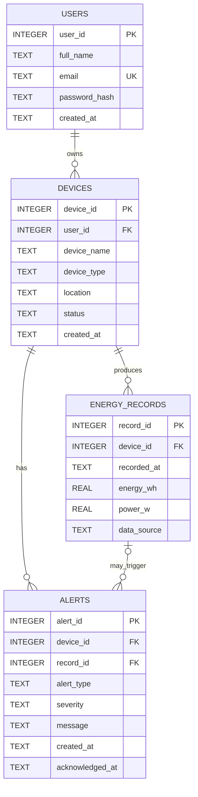

# AI-Assisted Smart Renewable Energy Monitoring Platform
## SQLite Database Design

### 1. Design Overview

The database stores users, their renewable energy devices, simulated energy readings, and alerts generated from those readings. A user can register multiple devices. Each device can have many energy records and alerts.

All timestamps are stored as UTC text in ISO 8601 format, for example `2026-10-30T09:10:00Z`. Energy and power values use consistent units: watt-hours (`Wh`) and watts (`W`). The application should label readings as simulated in the interface.

SQLite uses dynamic typing, so the declared types below follow common SQLite conventions. `CHECK` constraints help enforce valid values.

### 2. Table Definitions

#### `users`

Stores platform users who own devices.

| Column | SQLite type | Key | Constraints and purpose |
|---|---|---|---|
| `user_id` | `INTEGER` | Primary key | `NOT NULL`; use `INTEGER PRIMARY KEY` so SQLite assigns an ID. |
| `full_name` | `TEXT` | — | `NOT NULL`; trimmed value must not be empty. |
| `email` | `TEXT` | — | `NOT NULL`, unique case-insensitively; trimmed value must not be empty. |
| `password_hash` | `TEXT` | — | `NOT NULL`; stores a password hash, never a plaintext password. |
| `created_at` | `TEXT` | — | `NOT NULL`; UTC ISO 8601 timestamp. |

#### `devices`

Stores the solar panels and wind turbines registered by users.

| Column | SQLite type | Key | Constraints and purpose |
|---|---|---|---|
| `device_id` | `INTEGER` | Primary key | `NOT NULL`; generated by SQLite. |
| `user_id` | `INTEGER` | Foreign key | `NOT NULL`; references `users.user_id`. |
| `device_name` | `TEXT` | — | `NOT NULL`; trimmed value must not be empty. |
| `device_type` | `TEXT` | — | `NOT NULL`; must be `solar_panel` or `wind_turbine`. |
| `location` | `TEXT` | — | Optional location or site label. |
| `status` | `TEXT` | — | `NOT NULL`; must be `active`, `inactive`, or `maintenance`. |
| `created_at` | `TEXT` | — | `NOT NULL`; UTC ISO 8601 timestamp. |

**Foreign key behavior:** `user_id` references `users(user_id)` with `ON DELETE RESTRICT`. A user cannot be deleted while they still own devices.

#### `energy_records`

Stores simulated production readings for individual devices.

| Column | SQLite type | Key | Constraints and purpose |
|---|---|---|---|
| `record_id` | `INTEGER` | Primary key | `NOT NULL`; generated by SQLite. |
| `device_id` | `INTEGER` | Foreign key | `NOT NULL`; references `devices.device_id`. |
| `recorded_at` | `TEXT` | — | `NOT NULL`; UTC ISO 8601 time of the reading. |
| `energy_wh` | `REAL` | — | `NOT NULL`; must be greater than or equal to zero. |
| `power_w` | `REAL` | — | Optional instantaneous power; if present, must be greater than or equal to zero. |
| `data_source` | `TEXT` | — | `NOT NULL`; must be `simulated` for this project. |

**Foreign key behavior:** `device_id` references `devices(device_id)` with `ON DELETE RESTRICT`. This preserves historical readings and prevents deleting a device that has records.

#### `alerts`

Stores alerts generated from device readings or analysis.

| Column | SQLite type | Key | Constraints and purpose |
|---|---|---|---|
| `alert_id` | `INTEGER` | Primary key | `NOT NULL`; generated by SQLite. |
| `device_id` | `INTEGER` | Foreign key | `NOT NULL`; references `devices.device_id`. |
| `record_id` | `INTEGER` | Foreign key | Optional reference to the energy record that triggered the alert. |
| `alert_type` | `TEXT` | — | `NOT NULL`; for example, `anomaly` or `recommendation`. |
| `severity` | `TEXT` | — | `NOT NULL`; must be `info`, `warning`, or `critical`. |
| `message` | `TEXT` | — | `NOT NULL`; trimmed value must not be empty. |
| `created_at` | `TEXT` | — | `NOT NULL`; UTC ISO 8601 timestamp. |
| `acknowledged_at` | `TEXT` | — | Optional UTC ISO 8601 time when the alert was acknowledged. |

**Foreign key behavior:**

- `device_id` references `devices(device_id)` with `ON DELETE RESTRICT`.
- `record_id` optionally references `energy_records(record_id)`. If a record is removed, the alert can remain with its `record_id` set to `NULL`.
- When an alert references a record, that record should belong to the same device as the alert. This can be enforced with a composite foreign key on `(record_id, device_id)` referencing a unique `(record_id, device_id)` pair in `energy_records`.

### 3. Relationships

- **Users to devices — one-to-many:** A user may own multiple devices. Each device belongs to exactly one user.
- **Devices to energy records — one-to-many:** A device can have many readings over time. Each reading belongs to one device.
- **Devices to alerts — one-to-many:** A device can have multiple alerts. Each alert belongs to one device.
- **Energy records to alerts — one-to-many, optional:** A reading may be associated with multiple alerts, or none. An alert may refer to a specific reading, but it does not have to.

The ownership path for a reading or alert is `users → devices → energy_records/alerts`. This lets the application determine which user owns a device’s data without duplicating the user ID in every record.

### 4. Recommended Indexes

Indexes can speed up common lookups without changing the table relationships:

- `devices(user_id)` for listing a user’s devices.
- `energy_records(device_id, recorded_at)` for retrieving a device’s readings in time order or within a date range.
- `alerts(device_id, created_at)` for listing a device’s alerts by date.
- `alerts(severity, acknowledged_at)` for finding alerts by severity or acknowledgement status.

### 5. Mermaid ER Diagram

The database stores readings and alerts; analysis logic determines when an alert should be created. Since this project uses simulated data, records should retain the `simulated` source label so users can distinguish them from readings collected from physical equipment.